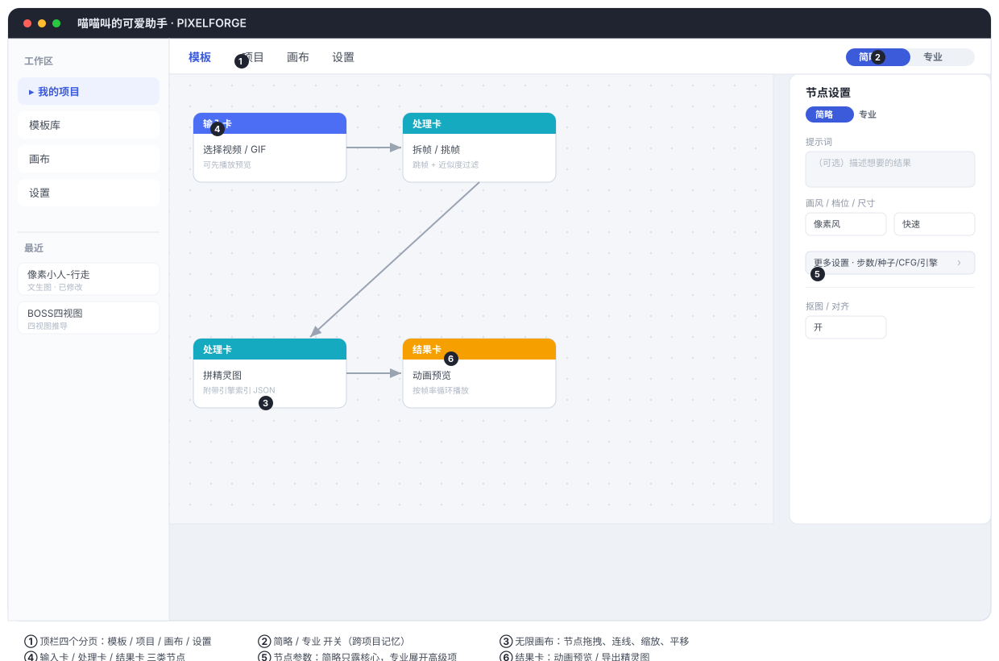

# 喵喵叫的可爱助手 · PIXELFORGE（Meowcute）

> **一个本地运行的 AI 游戏素材生成台。**
>
> 一句话定位：把一段文字描述、一张参考图、或一段视频 / GIF，用本地模型 + 确定性后处理，
> 规整成可以真正放进游戏引擎的**像素精灵、透明底 PNG、四视图、序列帧精灵图**。
> 全程离线、本机推理，不依赖任何云端 API。

- **项目名** `pixelforge`，**界面名**「喵喵叫的可爱助手」（Meowcute）。
- 全部推理在本地完成，素材不外泄、不联网、不按量计费。
- 以一个**无限画布工作流编辑器**为骨架：每个项目是一块画布，节点（生成卡 / 处理卡 / 结果卡）摆开、连线、随时回来继续。

---

## 界面一览



| 标注 | 说明 |
|---|---|
| ① | 顶栏四个分页：模板 / 项目 / 画布 / 设置 |
| ② | 简略 / 专业 开关（跨项目记忆，小白用简略、专家切专业） |
| ③ | 无限画布：节点拖拽、连线、缩放、平移 |
| ④ | 节点分三类：输入卡（喂素材）/ 处理卡（生成·精修·拆帧）/ 结果卡（预览·导出） |
| ⑤ | 节点参数面板：简略只露核心控件，专业展开步数 / 种子 / CFG / 引擎等 |
| ⑥ | 结果卡：动画预览 / 导出精灵图或 PNG |

第一次打开、只想快速上手，先看 [`QUICKSTART.md`](QUICKSTART.md)。

---

## 它能做什么：工作流模板

App 以「无限画布」组织，内置若干开箱即用的模板。每个模板定义好「输入 → 几步流程 → 产出」，
子步骤可在画布上展开、连线、复用。

| 模板 | 输入 → 产出 | 状态 |
|---|---|---|
| **像素精灵 · 文字生图** | 描述 → 像素风角色 | 可用 |
| **像素精修 · 图片转像素** | 任意图 → 像素 PNG | 可用 |
| **扣除背景 · 图片转透明底** | 任意图 → 透明 PNG | 可用 |
| **角色四视图** | 正视图 → 侧 / 背 / 右视图拼板 | 可用 |
| **文本生视频** | 一句话 + 可选参考图 → 一段视频 | 可用 |
| **视频转素材 · 序列帧精灵图** | 视频 / GIF → 拆帧挑帧 → 精灵图 → 动画预览 → Godot 4 工程包 | 可用 |
| 场景语义分层 | 场景图 → 多层视差素材 | 规划中 |

> 表中「视频转素材 · 序列帧精灵图」这条链是纯 CPU 处理（拆帧 / 拼图 / 预览），
> 不跑任何模型推理；其余需要出图 / 出视频的模板走本地模型。

**模板可以自己改，内置的也能改——在无限画布上改。** 模板页每张卡上有「在画布中编辑」：
它把模板打开成一份画布草稿（节点、连线、参数、提示词全在），像做项目一样拖节点、调参数、增删连线，
改完点顶栏「保存为模板」写回。内置模板的修改存成本地覆盖补丁（`data/template_overrides.json`，
只记录与出厂不同的字段），代码里的出厂定义不动，卡片上的「已修改」标记随时可以恢复默认；
想保留原版就「另存副本」。模板页上的文字（名称 / 描述 / 亮点 / 链路说明）用「改文案」。
草稿在项目列表里标成「模板编辑中」，关掉页面不会丢，下次点「在画布中编辑」接着改。

### 每个节点的「简略 / 专业」两种视图

节点参数很多时，提供两种面板深度，照顾不同用户：
- **简略模式**：只露出决定「结果是什么」的核心控件（提示词 / 档位 / 尺寸 / 画风 / 抠图开关），小白直接上手。
- **专业模式**：把决定「怎么算」的高级项（步数 / 种子 / CFG / 引擎 / 锚点 / 间距 / 后处理）折成一行「更多设置 · <里面有什么>」展开，专家按需深挖。

顶栏「简略 / 专业」开关跨项目记忆（localStorage）。

---

## 核心能力说明

### 像素风为什么能干净

光写一句 "pixel art" 出不了像素图——模型只会给你一张「看起来像像素」的模糊图。这里拆成三道互相兜底的关卡：

1. **提示词契约**（生成侧）：把网格尺寸、每格单色、限定色板、无抗锯齿、硬轮廓写进提示词，先让模型往网格上画。
2. **FFT 网格对齐**（后处理）：FFT 找出画面里真实的像素块大小 → Sobel 梯度峰吸附网格线 → 每格多数表决采样。块大小是量出来的，不靠猜。
3. **共享调色板**（后处理）：频次加权最远点采样压到 16 色内。按出现频次加权（而非面积占比，否则背景白占满色位），用感知距离（2/4/3）挑色。

后处理纯 numpy / PIL，几秒出结果，无 GPU 也能测。

### 抠图与白边处理

「图片转透明底」用 u2net 语义分割 → GrabCut → 颜色键，产出硬边 alpha。
针对**白底视频人物抠出来带白边**这一常见脏数据，去污判据用**混合比例**
`|边缘色 − 背景| / |角色内侧色 − 背景| < 0.85`（混进 >15% 背景才修），一套阈值通吃深底 / 浅底 / 彩底，
不再把混色边当背景留下。

### 视图推导（四视图）

编辑底座按「给一张角色图 + 一句中文指令，只改朝向、其余以参考图为准」接力推导：
正视图为锚，侧 / 背 / 右视图由指令接力生成，最后自动拼成四视图板。**忠实度（该动的动、不该动的别动）比好看更重要。**

### 视频 → 序列帧精灵图

「视频转素材」这条链：选视频 / GIF（可先播一遍确认）→ 拆成一摞帧，用「跳帧步长」+「近似度过滤」两把筛子去重，
逐张勾选想要的帧 → 选中帧按网格拼成一张精灵图（附带引擎索引 JSON）→ 动画预览按帧率循环播放
→「Godot 导出」直接出 **Godot 4 工程包**（`SpriteFrames` 的 `.tres` + `AnimatedSprite2D` 的 `.tscn` + zip）。
近似度在浏览器里用每帧 16×16 灰度指纹实时计算，拖滑杆零延迟。

Godot 包是确定性文本生成，不跑模型：`texture_filter = 1`（像素不糊）、`autoplay` 已设、原点对齐脚底
（`offset.y = -单元格/2`，`set_position()` 到地面线就站得住），所以解压到工程根目录、双击场景就能播。
`.tres` 引用的是 `res://<目标目录>/...` 绝对路径，导出时会自检包里每个 `res://` 引用都能命中；
图集/逐帧两种交付形态、动画名（可中文）、帧率、循环、原点都能在节点上改。

### 文本生视频 / 行走视频

- **文本生视频**：提示词（+ 可选参考图）→ 一段视频，走本地视频底座。
- **行走视频节点**：正视图 → 八方向立绘 + 行走视频，可在画布里手动搭建（底层节点保留，便于自定义方向组合）。

---

## 架构与技术栈

```
pixelforge/
├─ backend/               FastAPI 后端（全部 HTTP 端点 + 推理底座）
│  └─ app/
│     ├─ main.py           全部 HTTP 端点（生成/编辑/三视图/视频/序列帧/精灵图…）
│     ├─ config.py         运行时配置、模型扫描
│     ├─ templates.py      工作流模板定义（内置）
│     ├─ custom_templates.py  用户自定义模板持久化
│     ├─ template_overrides.py 内置模板的用户编辑（覆盖补丁，可恢复默认）
│     ├─ projects.py       项目 CRUD + 画布状态白名单清洗
│     ├─ storage.py        项目目录资产落盘、文件夹清单
│     ├─ styles.py         画风 / 背景预设 / 像素契约 / 提示词拼装
│     ├─ prompt_examples.py 内置示例（可增删改、软删除）
│     ├─ prompt_limits.py  提示词长度预算与上限
│     ├─ doctor.py         环境体检
│     ├─ progress.py       任务进度与取消（SSE）
│     ├─ providers/        diffusers 本地底座（Qwen-Image-2.1 / Wan / HunyuanVideo-1.5）
│     └─ pipelines/        perfect_pixel · palette · refine · matte ·
│                          clipframes · spritegrid · sequence · spritesheet ·
│                          threeview · walkvideo · videofx · mp4encode
├─ frontend/              React 18 + TypeScript + Vite（模板/项目/画布/设置四页）
├─ models/                本地模型权重（由使用方配置，详见文末）
├─ tools/                 辅助脚本（图标生成、诊断工具等）
├─ data/projects/         项目数据（画布状态 + 原图 + 精修成品）
└─ docs/                  调研与方案文档
```

- **后端**：FastAPI；推理走 `diffusers` 本地底座，家族互斥换出（不同时驻留）以省显存。
- **前端**：React 18 + TypeScript + Vite，无限画布交互（缩放 / 平移 / 拖节点 / 连线 / 删除）。
- **模型层**：
  - 图片：**Qwen-Image-2.1** 一个底座管所有图片——文生图、带参考图的指令改图（四视图推导）、原生 RGBA 透明输出；带不带参考图由节点决定，模型不用切，负面词走 true_cfg 真正生效。
  - 视频：**HunyuanVideo-1.5**（默认优先）/ **Wan2.2-TI2V-5B**（回退）两种底座，按权重就绪情况自动选择。
- **后处理纯 numpy/PIL**：FFT 网格对齐、共享调色板、抠图、拆帧拼图都不碰模型，几秒出结果，无 GPU 也能测。

---

## 快速开始

```bash
# Windows
start.bat

# macOS / Linux / Git Bash
./start.sh
```

首次自动装核心依赖并构建前端，然后打开 `http://127.0.0.1:8788`（手动指定端口可用 `PORT=8899 ./start.sh`）。

**没装 GPU 也能跑**：项目管理、提示词示例库、画风浏览、像素精修（纯 numpy/PIL）、视频拆帧拼图都可用，
只有「生成 / 编辑 / 视频生成」需要 GPU 推理依赖：

```bash
start.bat --gpu      # 或 ./start.sh --gpu
```

开发模式（前端热更新）：`start.bat --dev`（后端 8788 + Vite 5173）。其它参数：`--setup` 只装依赖、`--no-open` 不自动开浏览器、`--help` 看用法。

### 启动脚本的硬约束（Windows）

`start.bat` 必须保持 **CRLF 换行 + GBK（cp936）编码**，都是被 cmd.exe 逼的：

- **只给 LF 换行**：cmd 按 CRLF 切分语句，会把相邻两行粘成一条命令。
- **存成 UTF-8**：cmd 在行内按字节偏移解析，中文会把紧随其后的命令吃掉，报 `'xxx' 不是内部或外部命令`。编辑器的「另存为 UTF-8」是这个脚本的头号杀手。

### 找不到 / 选错 Python

脚本按此顺序挑解释器：`PYTHON` 环境变量 → `.venv/` → `python` → `py -3.13` → `-3.12` → `-3.11`。**越新越容易装不上**：

- `where python` 指向 `...\WindowsApps\python.exe` 是微软商店占位程序（退出码 9009），脚本用 `-c "import sys"` 实跑跳过它。彻底解决：设置 → 应用 → 高级应用设置 → 应用执行别名，关掉 `python.exe` / `python3.exe`。
- 系统 Python 太新（3.14+）会退化成源码编译，需 MSVC。用 3.12 最省事。

强制指定解释器：`set PYTHON=C:\Python312\python.exe && start.bat`。

---

## 项目文件夹：输入和产出都在里面

```
data/projects/<项目 id>/
  README.txt        自动生成的说明，翻目录时不用猜
  project.json      画布状态：生成卡描述/参考图引用/尺寸/张数/背景/画风/像素参数，
                    结果卡图片引用与元数据，以及画布缩放平移位置
  refs/             输入：上传的参考图（ref-*.png）
  images/           产出：模型原图（out-*.png）+ 像素精修成品（px-*.png）
```

文件名带时间戳和序号，例如 `out-20261021-093012-2-a1b2.png` = 那次生成的第二张原图。**整个文件夹拷走就能换机器继续**，路径无关。画布顶栏「文件夹」按钮可看清单并在文件管理器中打开。

---

## 测试

```bash
cd backend
python smoke_test.py     # 接口与画布状态清洗断言，不需要 GPU
python gpu_test.py       # 真实出图验证，需要 GPU
```

---

## 技术栈与版本约束

FastAPI + React 18 + TypeScript + Vite。GPU 推理依赖版本互相咬得很紧，已验证可用组合：

```
torch 2.6.0+cu124 · torchvision 0.21.0 · diffusers 0.41.0
transformers 5.20.1 · torchao 0.16.0 · accelerate 1.15.0
```

显存策略：家族互斥换出、transformer fp8 权重量化并落盘缓存、`enable_model_cpu_offload`，用完即放。

---

## 模型权重

本地模型权重由使用方自己配置：填绝对路径，或建目录联接 `mklink /J <项目>\models D:\code\pixelforge\models`。
代码按角色引用以下底座（权重需自备）：

| 底座 | 角色 | 备注 |
|---|---|---|
| **Qwen-Image-2.1** | 文生图 / 指令改图（四视图推导）/ 原生 RGBA 透明 | 唯一的图片底座，fp8 + cpu offload |
| **HunyuanVideo-1.5** | 行走视频 / 文本生视频 | 视频默认优先引擎（一致性、细节更好） |
| **Wan2.2-TI2V-5B** | 行走视频 / 文本生视频 | 视频回退引擎（像素风更保真），Apache 2.0 |

当前 `models/` 目录已就位的权重：`qwen-image-2.1`、`wan2.2-ti2v-5b`、`hunyuanvideo-1.5`。

> 视频引擎按权重就绪情况自动选择：HunyuanVideo-1.5 就绪就用它（默认），否则回退 Wan2.2-TI2V-5B。
> 各引擎帧数上限不同（HunyuanVideo-1.5 建议 ≤33 帧，超出会因序列长度超线性退化）；具体上限由 `/api/walkvideo/defaults` 回显。

---

## 文档与参考

- `QUICKSTART.md` —— 给第一次打开的人看的精简上手版（含界面功能示意图）。
- `docs/本地视频转序列帧精灵图-科普.md` —— 面向新手的科普介绍（概念 + 项目经验），本 README 的友好入口。
- `docs/Meowcute 视频生成序列帧方案分析.md` —— 视频生成链路的技术评审与架构方案（偏技术细节）。
- `docs/模型选型调研-2026-10-21.md` —— 改图 / 生图底座选型调研与实测。
- `README-归档说明.md` —— 原 PixelForge 归档说明与模型清单（历史参考）。

---

## 图标

标签页那只猫是本项目自己的管线生成的（拿产品当第一个用户）：

```bash
python tools/gen_icon.py          # 模型按像素契约出 4 张候选 → 精修到 32×32 → tools/icon_candidates.png
python tools/gen_icon.py --pick 1 # 选第 1 张，写成 favicon.ico / favicon-32.png / favicon-192.png
```

流程：Qwen-Image-2.1 按「32×32 网格 + 12 色 + 硬边」契约出图 → FFT 网格对齐精修 → 泛洪抠掉中灰背景。16px 档不走最近邻硬缩（会打断轮廓），改 2×2 块多数表决降采样。
